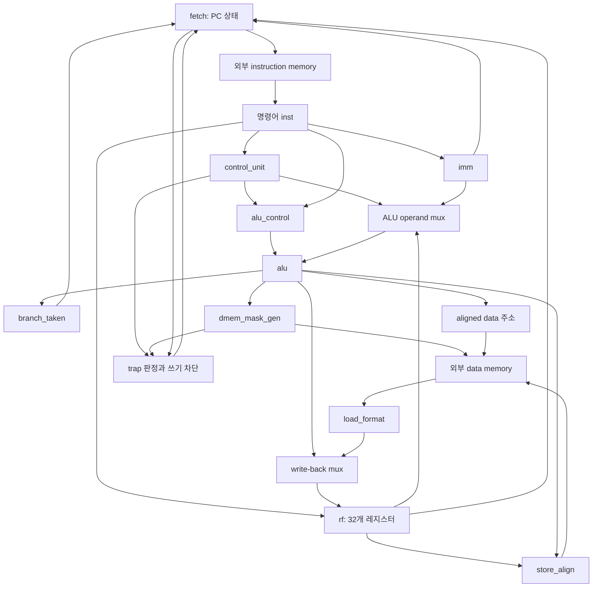

# 전체 구조와 이 프로젝트에서 쓰는 Verilog 문법

[분석 안내](README.ko.md) · [RTL 최상위 줄별 설명](rtl/hart.v.ko.md) · [테스트 설명](testing.ko.md)

## 1. 이 프로젝트가 만드는 것

이 프로젝트는 RISC-V RV32I의 주요 정수 명령을 실행하는 **32비트 단일 사이클 CPU 코어**이다. `hart`는 RISC-V 문맥에서 독립적으로 명령을 실행하는 하드웨어 실행 단위를 뜻한다. 여기서는 CPU 코어 최상위 모듈의 이름이다.

- RV32의 32는 레지스터와 기본 정수 연산 폭이 32비트라는 뜻이다.
- x0~x31의 레지스터가 있고 x0의 읽기는 항상 0이다.
- 각 명령어는 이 프로젝트에서 32비트, 즉 4바이트이다.
- PC는 현재 명령어의 **바이트 주소**이다. 다음 순차 명령은 PC+4에 있다.
- instruction memory와 data memory는 hart 밖에 있다. tb는 두 메모리를 별도로 모델링한다.
- stall/ready/valid 메모리 응답 핸드셰이크는 없다. 메모리 읽기 결과를 같은 사이클에 조합식으로 받을 수 있어야 한다.

코드에는 ADD/SUB/논리/시프트/비교, immediate 연산, load/store, branch, JAL/JALR, LUI/AUIPC 경로가 있다. EBREAK는 이 과제에서 종료 신호로 사용한다. FENCE와 ECALL은 이 디코더에서 허용하지 않으므로 이 구현을 완전한 RV32I 시스템이라고 단정하면 안 된다. CSR, 인터럽트, 예외 벡터, 캐시, 파이프라인도 없다.

분석의 일차 근거는 프로젝트 원문이다. 명령어 인코딩 중 확인이 필요한 부분은 [RISC-V 공식 인코딩 표](https://github.com/riscv/riscv-isa-manual/blob/main/src/unpriv/rv-32-64g.adoc), 제어 이전과 정렬 의미는 [공식 RV32I 설명](https://github.com/riscv/riscv-isa-manual/blob/main/src/unpriv/rv32.adoc)을 참고했다.

## 2. 디렉터리와 모듈 관계

```text
project3/
├─ rtl/              실제 CPU를 구성하는 Verilog
│  ├─ hart.v         최상위 배선, trap, write-back, retire
│  ├─ control_unit.v 명령어 해독과 주요 제어
│  ├─ imm.v          즉시값 재조립
│  ├─ rf.v           x0~x31 레지스터 저장
│  ├─ alu_control.v  ALU 세부 연산 제어
│  ├─ alu.v          연산과 비교
│  ├─ fetch.v        PC 상태와 다음 주소
│  ├─ dmem_mask_gen.v byte mask와 정렬 오류
│  ├─ store_align.v  저장 데이터를 lane에 배치
│  └─ load_format.v  읽은 데이터 선택·확장
├─ tb/tb.v           CPU를 실행시키는 시뮬레이션 환경
├─ tests/README      공개 테스트 범위 안내
├─ tests/asm/        테스트 프로그램 5개와 Makefile
├─ schematic/        명령 형식별 회로도 PDF
└─ traces/.gitkeep   추적 결과용 디렉터리 자리 유지
```

회로도 PDF는 존재를 확인한 참고 자료이며, 이 문서의 동작 판정과 줄 번호는 실제 RTL 기준이다.



그림의 화살표는 데이터·제어 의존성이다. 화살표 하나가 클록 한 번을 의미하지 않는다. 실제 메모리 enable, 세부 format 선택 등은 간략히 표시했다.

## 3. 단일 사이클을 시간 순서로 이해하기

상승 에지 직후 PC와 레지스터 값이 정해지면, 다음 상승 에지까지 조합 회로가 현재 명령의 결과를 만든다.

1. PC가 instruction memory 주소로 나간다.
2. 명령어가 들어오면 제어기가 opcode를 해독한다.
3. rf는 rs1/rs2를 조합식으로 읽고, imm은 immediate를 만든다.
4. operand mux와 ALU가 결과 또는 유효 주소를 만든다.
5. load이면 외부 메모리를 읽고 필요한 byte/half를 확장한다.
6. write-back 데이터와 다음 PC가 안정된다.
7. 다음 상승 에지에서 rf, PC, 필요한 데이터 메모리가 갱신된다.

따라서 Verilog 파일의 위쪽 코드를 실행한 뒤 아래쪽 코드를 순서대로 실행하는 CPU가 아니다. **모듈과 assign은 동시에 존재**한다. always 블록 내부 문장에는 시뮬레이션 실행 순서가 있지만 블록끼리는 병렬이며, 실제 회로는 신호 의존 관계대로 반응한다.

클록 주기는 가장 느린 조합 경로의 지연과 상태 소자의 setup 등 타이밍 요구를 만족해야 한다. 예를 들어 load 경로는 PC→instruction memory→decode/rf→ALU→data memory→load_format→rf까지 이어진다. 이 저장소에는 합성·정적 타이밍 분석 결과가 없으므로 최대 주파수는 알 수 없다.

## 4. 명령어의 필드

| 필드 | 위치 | 폭 | 용도 |
|---|---|---:|---|
| opcode | inst[6:0] | 7 | 명령 계열 |
| rd | inst[11:7] | 5 | 목적 레지스터 번호 |
| funct3 | inst[14:12] | 3 | 세부 연산/접근 크기 |
| rs1 | inst[19:15] | 5 | 첫 원본 레지스터 번호 |
| rs2 | inst[24:20] | 5 | 두 번째 원본 번호(R/S/B형 등) |
| funct7 | inst[31:25] | 7 | R형과 shift-immediate 등의 세부 연산 |

이 비트 위치들이 모든 명령에서 항상 같은 의미를 가지는 것은 아니다. I형의 inst[24:20]은 rs2가 아니라 immediate 일부이며, U형의 inst[19:15]도 rs1이 아니라 immediate 일부이다. hart는 모든 명령에서 필드를 잘라 내지만, 실제 사용 여부는 제어 신호로 결정된다. tb의 출력 포맷도 opcode에 따라 사용하지 않는 rs 필드를 `--`로 표시한다.

## 5. 이 코드에서 알아야 할 Verilog 문법

### module, 포트, 인스턴스

```verilog
module sample #(parameter WIDTH = 32) (
    input wire [WIDTH-1:0] a,
    output wire [WIDTH-1:0] y
);
    assign y = a;
endmodule

sample #(.WIDTH(32)) u_sample (.a(source), .y(result));
```

module은 회로의 설계 단위이다. parameter는 회로를 구성하는 elaboration 단계의 설정이며 매 사이클 바뀌는 입력이 아니다. `sample`은 모듈 종류, `u_sample`은 생성한 인스턴스 이름이다. `.a(source)`는 인스턴스의 a 포트와 상위의 source 신호를 연결한다. Verilog는 대소문자를 구분하므로 `PC`와 `pc`는 다른 이름이다.

### 비트 폭, 상수, 선택

| 표현 | 뜻 |
|---|---|
| `wire a` | 1비트 net |
| `wire [31:0] a` | 32비트 벡터; bit31이 최상위 |
| `a[7]` | bit 7 하나 |
| `a[15:8]` | 8비트 부분 선택 |
| `2'b10` | 2비트 이진수 10, 십진수 2 |
| `5'd31` | 5비트 십진수 31 |
| `32'h80000000` | 32비트 16진수 상수 |
| `32'b0` | 32비트 전체가 0 |
| `4'b00_10` | 밑줄은 가독성 구분자, 실제 값은 0010 |
| `32'hx` | 전체가 미정값 X인 32비트 값 |

폭을 명시하면 필요한 회로 폭과 확장 의도를 분명하게 전달할 수 있다. 이 RTL의 일반 wire 벡터는 `signed` 선언이 없으므로 기본적으로 unsigned 비교를 한다. 32'hffffffff 비트열이 -1인지 큰 양수인지는 해석 방식에 달려 있다.

### wire, reg, 메모리 배열

wire는 다른 회로나 assign이 구동하는 연결선이다. reg는 절차적 블록에서 값을 대입할 수 있는 Verilog 변수 유형이다. 이름만 보고 저장 소자를 판단하면 안 된다.

```verilog
reg [31:0] result;                // 조합 always에서 모두 대입하면 조합 회로
reg [31:0] register_file [0:31];   // 32비트 원소가 32개인 배열
reg [7:0] imem [0:1023];          // 8비트 원소 1024개, 1024바이트
wire [31:0] inst = i_imem_rdata;   // net의 연속 선언 대입
```

`wire x = expression`은 입력을 계속 따라가는 연속 연결이다. `reg x = expression`의 선언 초기화와 혼동하면 안 된다.

### assign과 조합 always

```verilog
assign eq = (a == b);
always @(*) begin
    case (select)
        1'b0: result = a;
        1'b1: result = b;
        default: result = 32'b0;
    endcase
end
```

assign은 우변 변화에 따라 출력을 갱신한다. `always @(*)`는 블록이 읽는 신호의 변화에 반응하는 조합식 작성 방식이다. 조합 회로로 만들려면 **모든 실행 경로에서 출력 값을 정해야 한다**. 일부 경로에서 대입하지 않으면 이전 값을 보관하는 래치가 추론될 수 있다. 이 RTL은 case의 default 등을 이용해 결과를 정한다.

### 클록 always와 = / <=

```verilog
always @(posedge clk) begin
    if (reset)
        pc <= RESET_ADDR;
    else if (!halt)
        pc <= next_pc;
end
```

posedge는 0→1 상승 에지이다. `=`는 blocking 대입으로 절차상 다음 문장 전에 대입이 반영된다. `<=`는 nonblocking 대입으로 우변을 평가하고 갱신을 NBA 단계로 예약한다. 이런 순차 블록에서는 현재 상태로 여러 다음 값을 계산한 뒤 같은 에지의 상태 갱신을 표현하기에 적합하다.

`else`가 없을 때의 의미도 문맥에 따라 다르다. 위 클록 블록에서 halt이면 PC를 유지하는 것은 의도한 레지스터 동작이다. 조합 블록의 누락 대입은 의도치 않은 래치가 될 수 있다.

### reset의 극성과 동기/비동기

`if (i_rst)`는 높은 값이 유효한 reset, `if (!rst_n)`는 낮은 값이 유효한 reset이다. 극성과 동기 여부는 다른 개념이다. fetch는 낮을 때 유효하지만 `always @(posedge clk)`이므로 **동기 reset**이다. reset 입력이 에지 사이에 바뀌어도 PC를 즉시 바꾸지는 않는다.

### 연산자

| 연산자 | 의미 | 이 프로젝트의 예 |
|---|---|---|
| `&`, `\|`, `^` | 비트 AND/OR/XOR | 데이터 논리 연산, 1비트 제어 결합 |
| `~` | 비트 NOT | trap 반전 |
| `~^` | 비트 XNOR | 부호 비트가 같은지 |
| `&&`, `\|\|`, `!` | 논리 AND/OR/NOT | rf 쓰기 조건, tb 제어 |
| `==`, `!=` | 같음/다름 | opcode 해독 |
| `<` | 작다 비교 | unsigned wire 비교 |
| `+`, `-` | 덧셈/뺄셈 | ALU, 주소 |
| `cond ? a : b` | 조건 선택 | mux |

예를 들어 4비트 `a & b`는 각 비트끼리 연산해서 4비트를 만들고, `a && b`는 두 벡터를 각각 참/거짓으로 보고 1비트를 만든다. 1비트 제어에서는 종종 결과가 같지만 벡터에서 같은 의미로 사용할 수 없다. X가 있으면 4상태 논리 규칙도 적용된다.

### 연결과 반복

```verilog
{a[15:0], 16'b0}             // 16비트와 16비트를 붙여 32비트
{{24{byte_value[7]}}, byte_value} // 부호 비트 24개 + 8비트
{sum[31:1], 1'b0}            // 최하위 1비트만 지우기
{address[31:2], 2'b00}       // 최하위 2비트 지우기
```

`{a,b}`는 concatenation, `{N{a}}`는 replication이다. 마지막 두 표현은 각각 2바이트 경계와 4바이트 경계로 주소를 내리므로 같은 연산이 아니다.

### case와 쉼표

```verilog
case (op)
    3'b010,
    3'b011: result = {31'b0, less_than};
    default: result = 32'b0;
endcase
```

쉼표로 연결한 case 항목들은 같은 문장을 공유한다. C 언어의 fall-through가 아니다. 일반 case는 X/Z까지 정확히 매칭하므로 선택값이 미정이면 default로 갈 수 있다.

### 전처리와 시뮬레이션 전용 문법

`` `default_nettype none ``은 오타를 암묵적 wire로 받아들이지 않도록 한다. `` `ifdef RISCV_FORMAL ``은 해당 매크로가 정의된 빌드에서만 내용을 포함한다. 이런 전처리는 실행 중 조건 분기가 아니다.

tb의 `initial`, `#5`, `@(negedge clk)`, `$readmemh`, `$display`, `$write`, `$finish`는 시뮬레이션 시작, 시간 진행, 이벤트 대기, 파일 입출력, 출력, 종료를 표현한다. 일반 CPU RTL에 그대로 넣어 실제 파일을 읽거나 콘솔을 출력하는 하드웨어가 되는 것은 아니다.

## 6. 실제 명령어가 통과하는 경로

### ADD: `add x5, x1, x2`

x1=7, x2=9라고 하자. control_unit은 R형을 감지해 Src1=rs1, Src2=rs2, ALUOp=10, RegWrite=1을 만든다. alu_control은 funct3=000, inst[30]=0에서 opsel=000, sub=0을 만든다. ALU는 16을 계산하고 write-back mux는 ALU 결과를 선택한다. 다음 상승 에지에 x5=16, PC=PC+4가 된다. R형 immediate는 X지만 선택하지 않으므로 정상 연산에는 필요 없다.

### ADDI: `addi x1, x1, -1`

I형 immediate의 12비트 0xfff를 imm이 0xffffffff로 확장한다. ALU는 rs1+immediate를 계산한다. sub는 I형에서 0이다. 음수를 더하는 것으로 감소를 구현한다. 같은 명령에서 x1을 읽고 쓰더라도 BYPASS_EN=0이므로 읽기는 이전 저장값을 사용한다.

### LUI와 AUIPC

`lui x5, 0x12345`는 immediate=0x12345000을 만든 뒤 0+immediate를 x5에 쓴다. `auipc x5, 0x12345`는 현재 PC+0x12345000을 쓴다. AUIPC의 기준은 PC+4가 아니다.

### LOAD: `lb x5, 2(x1)`

x1=0x100이라고 하자. ALU의 유효 주소는 0x102이다. 외부 주소는 0x100으로 정렬하고 offset=2를 별도로 보존한다. mask=0100으로 lane 2를 읽고 load_format은 bits23:16을 부호 확장해 x5에 쓴다. 그 byte가 0x80이면 x5=0xffffff80이다. 같은 주소를 LBU로 읽으면 0x00000080이다.

### STORE: `sh x2, 2(x1)`

x1=0x100, x2=0x11223344라면 유효 주소=0x102, 외부 주소=0x100, mask=1100, wdata=0x33440000이다. 다음 상승 에지에 dmem[0x102]=0x44, dmem[0x103]=0x33을 쓴다. 비활성 lane은 갱신하지 않는다. `sh x2,1(x1)`은 misaligned이므로 trap이 발생하고 쓰기를 막는다.

### BRANCH: `bne x1, x2, label`

ALU는 rs1/rs2를 받아 동등 플래그를 만든다. BNE의 bcomp=0, bnot=1이므로 branch_taken=eq XOR 1이다. 값이 다르면 fetch는 PC+branch immediate를 목표로 선택한다. branch immediate는 이미 byte 오프셋이므로 다시 2를 곱하면 안 된다. 값이 같으면 PC+4로 간다. 목적지가 비정렬이어도 실제로 타지 않는 branch는 이 코드에서 정렬 trap을 만들지 않는다.

### JAL과 JALR

JAL은 PC+J immediate로 이동하고 rd에는 PC+4를 쓴다. JALR은 (rs1+I immediate)의 bit0을 지운 곳으로 이동한다. 이때 ALU는 목표 주소를 만드는 대신 PC+4+0을 계산해 복귀 주소를 제공하고, 목표 주소는 fetch의 별도 덧셈기가 만든다.

PC=0x40, rs1=0x101, immediate=2인 JALR의 합은 0x103이고 bit0 정리 후 0x102이다. bit1이 남아 있으므로 4바이트 정렬 조건을 만족하지 못한다. hart는 trap을 내고 rd 쓰기와 redirect를 막으므로 다음 PC 후보는 0x44이다.

### EBREAK와 trap

EBREAK는 halt를 켜서 PC를 유지하고 tb가 시뮬레이션을 종료하게 한다. 반면 trap은 표시되고 쓰기를 막지만 CPU를 정지시키거나 예외 처리기로 보내지 않는다. 이 차이를 놓치면 trace를 잘못 해석할 수 있다. 자세한 한계는 [구현 검토](review.ko.md)에 정리했다.
